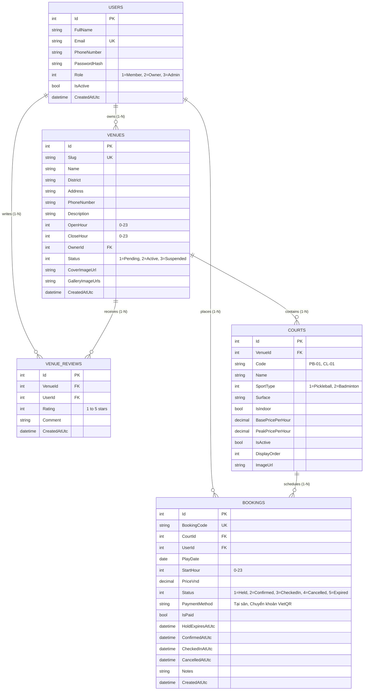

# Sơ Đồ Cơ Sở Dữ Liệu (Entity-Relationship Diagram - ERD)

### Các chỉ mục quan trọng (Indexes & Constraints):
1. **Filtered Unique Index (Chống trùng giờ đặt):** `[CourtId, PlayDate, StartHour] WHERE Status IN (1, 2, 3)`
2. **Composite Unique Index (Mã sân trong cụm sân):** `[VenueId, Code]`
3. **Unique Email Index:** `[Email]`
